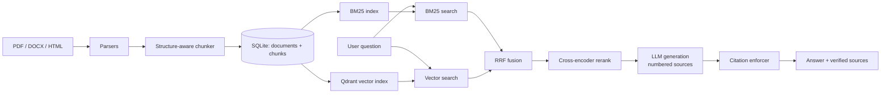

# Ask My Docs: Enterprise Knowledge Assistant

A document question-answering system for enterprise knowledge bases. It ingests PDF, Word, and HTML files, retrieves relevant passages with **hybrid search (BM25 + vector)**, reranks them with a **cross-encoder**, and generates answers in which **every claim carries a verified citation**. Claims that cannot be traced to a retrieved source are stripped before the answer reaches the user.

The project's central idea: *asking an LLM to cite its sources is not enough.* This system checks the citations after generation and removes anything unsupported.

---

## Features

- **Multi-format ingestion**: PDF (page-aware), DOCX (headings and tables), and HTML (boilerplate stripped).
- **Structure-aware chunking**: chunks respect headings, never span PDF pages, and carry `doc_id`, `section`, and `page` metadata so every citation can point to an exact location.
- **Hybrid retrieval**: BM25 for exact terms, IDs, and figures; dense embeddings for semantic matches; merged with Reciprocal Rank Fusion (RRF).
- **Cross-encoder reranking**: fused candidates are rescored with Cohere Rerank for query-aware ordering.
- **Citation enforcement**: a post-generation verifier drops invalid, missing, and unsupported citations (details below).
- **CI-gated evaluation**: a golden question set and a GitHub Actions workflow fail the build if retrieval or citation enforcement regresses.
- **Fully runnable offline**: deterministic fake components let you run and test the whole pipeline with no API keys.

---

## Architecture



### How citation enforcement works

Retrieved chunks are shown to the model as numbered sources (`[1]`, `[2]`, ...). After generation, `citation_enforcer.py` splits the answer into sentences and keeps a sentence only if it has at least one citation that is both:

1. **Valid**: the cited source number was actually provided to the model.
2. **Supported**: the sentence shares enough content with the cited chunk's text.

Everything else is stripped, and the answer is rebuilt from the surviving sentences. Partially wrong citation lists (for example `[1][99]`) are corrected to `[1]`. If nothing survives, the system returns an explicit "I don't have enough information in the provided sources" response rather than an empty or invented one.

> **Limitation:** the "supported" check uses lexical overlap, not a true entailment (NLI) model. It catches fabricated facts attached to real citations, but not subtle logical misreadings. The check sits behind a single function so a real NLI model or LLM-as-judge can replace it.

---

## Tech stack

| Layer | Technology |
|---|---|
| Parsing | `pdfplumber`, `python-docx`, `BeautifulSoup` + `lxml` |
| Metadata store | SQLite |
| Sparse retrieval | `rank_bm25` |
| Vector store | Qdrant (embedded local mode, or hosted via URL + API key) |
| Embeddings | OpenAI `text-embedding-3-small` |
| Reranker | Cohere Rerank (`rerank-v3.5`) |
| Generator | Anthropic Claude |
| Testing / CI | `pytest`, GitHub Actions |
| API / UI | FastAPI, Streamlit *(in progress)* |

---

## Quickstart

### 1. Install

```bash
git clone https://github.com/Srivatsa2004/Ask-My-Doc.git
cd Ask-My-Doc
python3 -m venv .venv
source .venv/bin/activate          # Windows: .venv\Scripts\activate
pip install -r requirements.txt
```

### 2. Run offline (no API keys needed)

```bash
python3 scripts/ingest.py --input data/raw --domain enterprise_kb
python3 scripts/build_index.py --fake-embedder
python3 scripts/ask.py "what is the meal reimbursement limit for domestic travel" --fake-all
```

> Offline mode uses deterministic stand-ins for the embedder, reranker, and generator. They exercise the full pipeline mechanically but are **not semantically meaningful**; answers will not be real. Use it to verify the plumbing, not answer quality.

### 3. Run with real models

```bash
export OPENAI_API_KEY=sk-proj-...
export COHERE_API_KEY=...
export ANTHROPIC_API_KEY=sk-ant-...

python3 scripts/build_index.py
python3 scripts/ask.py "what is the meal reimbursement limit for domestic travel"
```

Expected shape of the output:

```
Answer: Meal reimbursements are capped at $75 per day for domestic travel. [1]

Sources:
  - expense_policy_... | ... Reimbursement Limits, p.1 [expense_policy_...::chunk0000]
```

### 4. Add your own documents

Drop PDF, DOCX, or HTML files into `data/raw/`, then re-run `ingest.py` and `build_index.py`. Re-ingesting is safe: documents are deduplicated by content hash.

---

## Testing and evaluation

```bash
python3 -m pytest tests/ -v
```

Currently **36 passed, 2 skipped**. The 2 skipped tests need live API keys (see below).

### Test tiers

| Tier | Needs API keys | Runs in CI | Checks |
|---|---|---|---|
| **1. Hard gate** | No | Always | Chunking correctness, retrieval recall on the golden set, and that fabricated claims never survive citation enforcement |
| **2. Real-quality** | Yes (OpenAI + Cohere + Anthropic) | Only if repo secrets are set | Correct refusal on unanswerable questions; end-to-end pass rate on the golden set |

Tier 2 skips cleanly when keys are absent instead of failing the build.

### The adversarial enforcement test

`tests/test_eval_harness.py` runs **every golden-set question** through a generator that deliberately hallucinates on every call (a fabricated figure with an invalid citation, plus an uncited claim) and asserts that neither ever appears in a final answer. This tests the enforcement guarantee directly rather than trusting the prompt.

### Eval report

```bash
python3 eval/run_eval.py --fake-all        # offline
python3 eval/run_eval.py                   # real pipeline (needs all three keys)
python3 eval/run_eval.py --fake-all --hallucinate   # stress-test enforcement
```

Reports retrieval recall, correct-refusal rate (unanswerable questions correctly declined), false-refusal rate, and average claims dropped per answer.

---

## Results and honest status

| Measurement | Result | How to read it |
|---|---|---|
| Hallucinated claims surviving enforcement | **0 across all 25 golden questions** | Verified against a deliberately hallucinating generator. Measures the guardrail, not overall answer quality. |
| Retrieval recall on golden set | **100% (24/24 answerable questions)** | Measured offline on a **4-chunk demo corpus**, where retrieving the right chunk in the top 5 is easy. Shows the pipeline works, not retrieval quality at scale. |


---

## Design decisions and known limitations

- **Strip, don't regenerate.** Unsupported claims are removed rather than triggering a second LLM call. This is cheaper and faster, and the user still receives whatever part of the answer was grounded.
- **Lexical support check.** Claim verification uses word overlap, not an NLI model (see the note above).
- **Refusal is the LLM's job.** On the small demo corpus, no single retrieval-score threshold cleanly separated answerable from unanswerable questions: the one negative example scored in the middle of the positive examples' range. The offline `FakeSmartGenerator` is therefore a documented-imperfect heuristic, and real refusal quality is measured only with the Claude generator.
- **Approximate token counting.** Chunk sizing uses a regex tokenizer instead of a model-specific BPE tokenizer, to avoid a network dependency at ingestion time. It runs slightly high versus true token counts, which keeps chunks safely under context limits.
- **Small demo corpus.** The bundled sample data (3 documents, 4 chunks, 25 golden questions) validates the pipeline. It is not a benchmark.
- **`rank_bm25` quirk.** Its IDF formula yields exactly zero for a term present in half of a 2-document corpus. This only affects toy-sized test corpora.

---

## Project structure

```
ask-my-docs/
├── src/
│   ├── ingestion/
│   │   ├── parsers.py            # PDF / DOCX / HTML -> sections
│   │   └── chunker.py            # sections -> page-exact, heading-aware chunks
│   ├── retrieval/
│   │   ├── embeddings.py         # OpenAIEmbedder / offline fake
│   │   ├── bm25_index.py         # sparse retrieval
│   │   ├── vector_store.py       # Qdrant wrapper (local or hosted)
│   │   ├── fusion.py             # Reciprocal Rank Fusion
│   │   ├── reranker.py           # CohereReranker / offline fake
│   │   └── hybrid_retriever.py   # orchestrates search + fusion + rerank
│   ├── generation/
│   │   ├── prompt.py             # numbered-source prompt
│   │   ├── generator.py          # AnthropicGenerator + offline fakes
│   │   ├── citation_enforcer.py  # verify and strip unsupported claims
│   │   └── pipeline.py           # AskPipeline: retrieve -> generate -> enforce
│   ├── pipeline_factory.py       # builds the pipeline from env vars
│   └── storage.py                # SQLite documents + chunks
├── scripts/                      # ingest.py, build_index.py, query.py, ask.py
├── eval/                         # golden_set.json, harness.py, run_eval.py
├── tests/                        # unit tests + CI-gated eval tests
├── data/raw/                     # sample PDF, DOCX, HTML documents
└── .github/workflows/eval.yml    # CI
```

---

## Roadmap

- [x] Ingestion and structure-aware chunking
- [x] Hybrid retrieval (BM25 + vector + RRF)
- [x] Cross-encoder reranking and golden evaluation set
- [x] Citation-constrained generation and enforcement
- [x] Eval harness and GitHub Actions CI gate
- [ ] FastAPI backend and Streamlit UI *(in progress)

---

## Configuration reference

| Variable | Used for |
|---|---|
| `OPENAI_API_KEY` | Embeddings (`text-embedding-3-small`) |
| `COHERE_API_KEY` | Reranking |
| `ANTHROPIC_API_KEY` | Answer generation |

If any of the three is missing, `src/pipeline_factory.py` falls back to the offline components and prints a warning.
